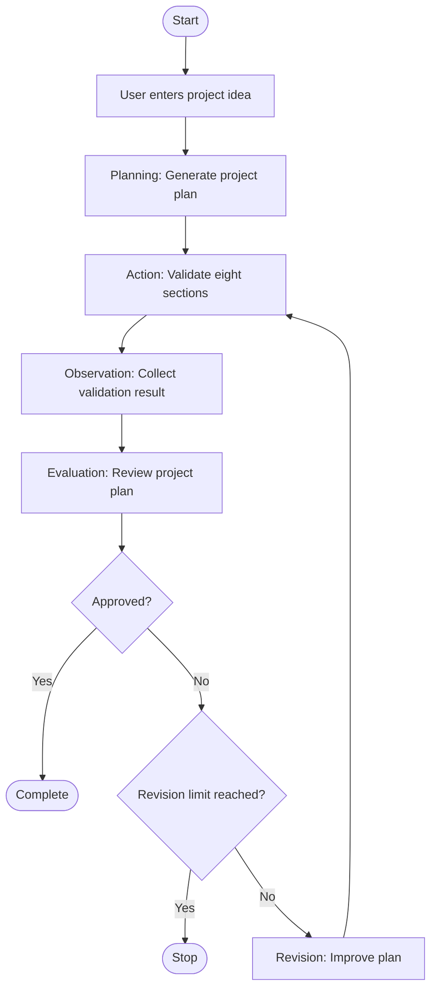

# Agentic AI Project Planner

An Agentic AI workflow that generates, validates, evaluates, and improves project plans using Gemini API, LangGraph, Python, and Streamlit.

## Project Overview

The AI Project Planner accepts a project idea from the user and generates a structured project plan.

It follows an agentic workflow in which multiple nodes perform different tasks, evaluate results, and use feedback to improve the generated plan.

## Features

- Generates detailed project plans using Gemini AI.
- Validates eight required project-plan sections.
- Evaluates plans for completeness, clarity, and feasibility.
- Revises plans using evaluator feedback.
- Supports configurable revision limits.
- Provides a web interface using Streamlit.
- Supports different project ideas.

## Technology Stack

| Technology | Purpose |
|---|---|
| Python | Main programming language |
| Gemini API | AI-powered planning and evaluation |
| LangGraph | Workflow orchestration |
| Streamlit | Web application interface |
| python-dotenv | Environment variable management |

## Agentic AI Workflow



## Workflow Components

1. **Planning Node:** Generates a structured project plan using Gemini.
2. **Action Node:** Checks whether all eight required sections are present.
3. **Observation:** Uses the validation result as feedback for evaluation.
4. **Evaluation Node:** Reviews the plan using Gemini.
5. **Revision Node:** Improves the plan using evaluation and validation feedback.
6. **Conditional Routing:** Determines whether to approve, revise, or stop.

## Project Plan Sections

Every generated plan is checked for these eight sections:

1. Project Overview
2. Objectives
3. Technology Stack
4. Tasks and Milestones
5. Timeline
6. Resources Required
7. Expected Deliverables
8. Potential Risks

## Installation and Setup

### 1. Clone the repository

```bash
git clone https://github.com/nikitha-1709/agentic-ai-workflow.git
cd agentic-ai-workflow
```

### 2. Create a virtual environment

```bash
python -m venv venv
```

### 3. Activate the environment

Windows PowerShell:

```powershell
.\venv\Scripts\Activate.ps1
```

### 4. Install dependencies

```bash
pip install langgraph langchain-google-genai python-dotenv streamlit google-genai
```

### 5. Configure the Gemini API key

Create a `.env` file in the project directory:

```text
GOOGLE_API_KEY=your_gemini_api_key
```

Never upload your API key or `.env` file to GitHub.

### 6. Run the application

```bash
streamlit run app.py
```

The application will open in your browser at:

`http://localhost:8501`

## Testing

The application was tested with different project ideas:

| Test | Input | Result |
|---|---|---|
| 1 | Attendance Management System | APPROVED |
| 2 | Plant Disease Detection System | APPROVED |

The feedback loop was also tested separately using a controlled revision test:

`REVISE → Revision → APPROVED`

## Feedback Loop and Termination

When the evaluator requests improvements, the workflow sends the plan back to the revision node.

The revised plan is validated and evaluated again.

The workflow terminates when:

- The plan is approved, or
- The maximum revision limit is reached.

A LangGraph recursion limit is also configured as an additional execution safeguard.

## Challenges and Lessons Learned

- Configuring the Gemini API and selecting a supported model.
- Integrating the Gemini client with LangGraph.
- Handling inconsistent LLM evaluation responses.
- Implementing conditional routing and a revision loop.
- Preventing unlimited workflow execution using revision limits.
- Building a web interface to interact with the workflow.

## Limitations

- Validation currently checks for the presence of eight required sections.
- Evaluation depends on the LLM response and may vary between runs.
- The agent generates and improves project plans; it does not execute the proposed projects.

## Future Enhancements

- Add downloadable PDF project plans.
- Improve validation with deeper quality checks.
- Add project-plan history.
- Support more languages.
- Add human approval before finalizing a plan.

## Author

Developed as an Agentic AI academic project.
